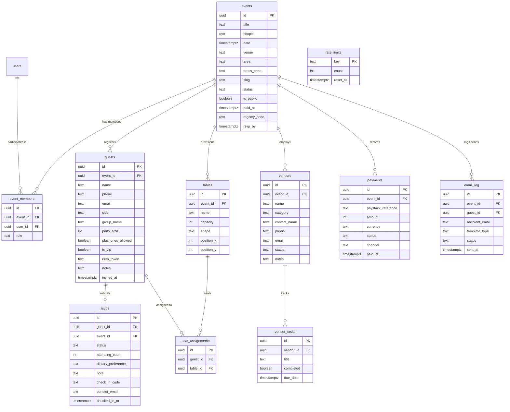

# Àríyá Architecture Documentation

## 1. System Overview

Àríyá (by OwambePlan) is an event and wedding planner for Nigerian couples and planners. It replaces guest lists and RSVPs scattered across WhatsApp groups. Every guest receives a personal, unguessable RSVP link. Planners pay per celebration.

## 2. Repository Layout & Asset Isolation

The repository is partitioned into two distinct domains:

1. **Legacy Marketing Site & Wedding Film (`public/site/`)**
   - Served framework-free via Next.js rewrites at `/`, `/about`, `/product`, `/pricing`, `/story`, and `/film`.
   - Static assets for the marketing site and film reside strictly under `public/site/assets/`.
   - **Crucial Routing Rule**: The path prefix `/assets/*` is strictly reserved for the legacy static site rewrite (mapping `/assets/:path*` to `/site/assets/:path*`). **Application code under `src/` must NEVER serve files from or reference `/assets/`**. Application static assets must be placed in `src/assets/` or stored in Supabase Storage.
   - The wedding film and three.js are completely isolated and must never be imported into any application bundle under `src/`.

2. **Application Platform (`src/`)**
   - Built on Next.js 16 (App Router), React 19, TypeScript strict mode, and Tailwind CSS v4.
   - Follows a feature-sliced architecture under `src/features/` with isolated actions, queries, schemas, and components.
   - Authenticated shell layout (FINAL 01) with responsive mobile views (MOBILE 01–08).

3. **Music (`public/site/assets/music.mp3`)**
   - "Forever Sweet" by Dotti, a commercial track, served publicly with the film and About page by the owner's choice (copyrighted: remove or replace it if no licence is in place).
   - If the file is missing, both pages fall back to their generated Web Audio groove.

## 3. Legacy URL Resolution Matrix

To ensure that existing links within static marketing pages resolve seamlessly without altering legacy markup:

| Request URL      | Routing Type   | Target Destination    | Status / Behavior                                    |
| ---------------- | -------------- | --------------------- | ---------------------------------------------------- |
| `/`              | Rewrite        | `/site/index.html`    | "The Yes" wedding film                               |
| `/about`         | Rewrite        | `/site/about.html`    | About Àríyá                                          |
| `/about.html`    | Rewrite        | `/site/about.html`    | Resolves relative links inside legacy pages          |
| `/product`       | Rewrite        | `/site/product.html`  | Product details                                      |
| `/product.html`  | Rewrite        | `/site/product.html`  | Resolves relative links inside legacy pages          |
| `/pricing`       | Rewrite        | `/site/pricing.html`  | Pricing overview                                     |
| `/pricing.html`  | Rewrite        | `/site/pricing.html`  | Resolves relative links inside legacy pages          |
| `/story`         | Rewrite        | `/site/story.html`    | Wedding story                                        |
| `/story.html`    | Rewrite        | `/site/story.html`    | Resolves relative links inside legacy pages          |
| `/film`          | Rewrite        | `/site/film.html`     | Film redirector                                      |
| `/film.html`     | Rewrite        | `/site/film.html`     | Resolves legacy film page requests                   |
| `/assets/:path*` | Rewrite        | `/site/assets/:path*` | Legacy textures, scripts, posters                    |
| `/planner.html`  | Redirect (307) | `/events`             | Replaced by real authenticated celebrations hub      |
| `/rsvp.html`     | Redirect (307) | `/sign-in`            | Temporary in Phase 2; Phase 4 points to `/i/[token]` |

## 4. Technology Stack & Decision Records

- **Framework**: Next.js 16 (App Router, Turbopack)
- **Runtime**: React 19, TypeScript (strict mode)
- **Styling**: Tailwind CSS v4 with design tokens defined as CSS variables
- **UI Primitives**: Radix UI (shadcn/ui style), customized to Àríyá tokens
- **Data & Auth**: Supabase (Postgres, Auth, Storage) with Row Level Security on every table
- **Form Management**: React Hook Form with Zod schemas
- **Tables & DND**: TanStack Table for registry, dnd-kit for seating chart
- **Emails**: Resend + React Email templates
- **Payments**: Paystack in test mode, with server action initialization and idempotent webhook verification

## 5. Phase 2 Security & Database Architecture

### Row-Level Security (RLS) & Definer Helpers

- **Security-Definer Membership Functions**: All policy checks avoid recursive self-joins by utilizing `public.is_event_member(p_event_id uuid)` and `public.has_event_role(p_event_id uuid, p_roles text[])`. Both helpers are declared with `STABLE`, `SECURITY DEFINER`, and `SET search_path = ''`.
- **Role Isolation**: Event owners and planners retain write access; staff members are restricted to check-in operations and read-only guest inspection.
- **Service-Role Only Logging**: The `email_log` table is strictly writable by the service role only; authenticated event members have read-only access for transparency.

### Stored Procedures (RPCs)

1. **`create_event(...)`**: Atomically inserts the celebration and assigns owner membership in a single transaction, returning the event ID and sovereign URL slug.
2. **`get_invitation(p_token text)`**: Sanitized public invitation projection for anon/authenticated callers. Exposes only guest first name, display name, party size, plus-one allowance, RSVP fields, and event metadata. Explicitly filters out phone, email, private notes, VIP flags, tokens, and payment records.
3. **`submit_rsvp(...)`**: Validates event active status and `rsvp_by` deadline. Enforces `1 <= count <= party_size (+1 if allowed)` for accepted RSVPs, requires 0 for declined RSVPs, automatically unseats declined parties, and truncates text fields.
4. **`get_user_events_with_metrics()`**: Single-query aggregation computing portfolio metrics (accepted, awaiting, declined, seated, unassigned) across all user memberships, eliminating N+1 query patterns.

### Concurrency & Capacity Locking

- **`check_table_capacity()`**: Executes `SELECT capacity FROM public.tables WHERE id = NEW.table_id FOR UPDATE` to lock table rows during seating assignments. Dynamically tallies accepted guests by attending count (or party size if pending) to guarantee seating allocations never exceed physical table constraints.

### Route Protection Middleware

- **Unauthenticated Access**: Directs unauthenticated visitors attempting to access `/events/**` to `/sign-in?next=...` while maintaining full query string state.
- **Authenticated Access**: Bounces logged-in users visiting authentication routes (`/sign-in`, `/sign-up`, `/forgot-password`, `/reset-password`) to their destination or `/events`.

## 6. Performance Baselines & Client Bundle Budgets

To protect guest experiences on low-bandwidth and mobile connections common across celebratory contexts, bundle sizes are tracked against strict budgets.

### Total First-Load JS Baseline (Next.js 16 Production Build)

The framework baseline (shared React 19 framework, Turbopack runtime, and root layout) is **489.7 KB uncompressed (147.7 KB gzipped)**.

| Route                      | Page Type            | Total First-Load JS (Uncompressed) | Total First-Load JS (Gzipped) | Page-Specific Delta (Gzipped) |
| -------------------------- | -------------------- | ---------------------------------- | ----------------------------- | ----------------------------- |
| `/i/[token]`               | Guest Pass & RSVP    | 523.2 KB                           | 159.8 KB                      | +12.0 KB                      |
| `/e/[slug]`                | Public Event Gazette | 492.2 KB                           | 148.9 KB                      | +1.2 KB                       |
| `/events`                  | Celebrations Hub     | 585.6 KB                           | 177.8 KB                      | +30.1 KB                      |
| `/events/[eventId]/guests` | Guest Registry       | 818.2 KB                           | 245.7 KB                      | +98.0 KB                      |

### Bundle Budget Rule

- **Guest Routes Budget**: Guest-facing routes (`/i/[token]`, `/e/[slug]`) must add **no more than 20 KB of page-specific JS (gzipped)** on top of the shared framework baseline.
- Heavy client libraries (TanStack Table, QR scanners, charting) are dynamically imported or strictly isolated to authenticated planner routes.

## 7. Rate Limiter Security & Fail-Closed Policy

- **Atomic Database Counter**: Rate limiting is tracked via the `public.rate_limits` table and the `public.hit_rate_limit(p_key text, p_limit int, p_window interval)` security-definer function.
- **Service-Role Execution Only**: Direct `EXECUTE` privileges on `hit_rate_limit` are revoked from both `anon` and `authenticated` roles. Rate limit checks must be performed exclusively from trusted server code using the Supabase service-role admin client.
- **HMAC IP Anonymization**: Client IP addresses are never stored in plain text or raw form. In-flight client IPs are hashed with HMAC-SHA256 keyed by `RATE_LIMIT_SECRET`.
- **Fail-Closed Security**: In the event of a database connectivity issue, RPC error, or unexpected exception during a rate limit evaluation, the limiter strictly **fails closed** (`success: false`, `remaining: 0`), preventing brute-force attacks or resource exhaustion during degraded service states.
- **Bounded Table Growth**: Old and expired rate-limit records are pruned automatically inside `hit_rate_limit` transactions (`reset_at < clock_timestamp() - interval '1 hour'`), ensuring storage bounds remain constant.

## 8. Role Hierarchy & Team Access Matrix

Àríyá enforces Nigerian celebration operational hierarchies using database triggers (`tr_event_member_security`), row-level security policies, and server action guards across four distinct roles:

| Role        | Description                    |    Manage Roles     | Manage Guests / Seating |   Check-in Desk    | View Billing & Payments |
| :---------- | :----------------------------- | :-----------------: | :---------------------: | :----------------: | :---------------------: |
| **Owner**   | Celebration host / creator     |  Full (All roles)   |           Yes           |        Yes         |           Yes           |
| **Planner** | Hired lead wedding coordinator | Couple & Staff only |           Yes           |        Yes         |           Yes           |
| **Couple**  | Celebrants (Bride & Groom)     |      Read-only      |     View / Overview     |        View        |           Yes           |
| **Staff**   | On-the-day reception concierge |        None         |   Read-only registry    | Yes (Scan & admit) | **Blocked (403 / RLS)** |

### Security Guarantees

- **No Self-Demotion / Mutation**: No team member may alter their own role (`old.user_id = auth.uid()`).
- **Last Owner Protection**: A database trigger strictly prevents removing or demoting the final remaining owner of any celebration workspace.
- **Invitation Token Expiration**: Team invitations generate cryptographically random 22+ character Base62 tokens expiring after 7 days, accepted strictly after sign-in.
- **Billing Shielding**: Staff members are blocked from viewing invoices or transaction records at both the UI and database row-level security (`public.has_event_role(event_id, array['owner', 'planner', 'couple'])`).

## 9. Billing, Paystack Webhooks & Unpaid Restrictions

### Free Tier Limits vs. Celebration Pass

- **Unpaid Tier Restriction**: Free celebration workspaces may invite and dispatch reminders to a maximum of **20 guests**. Attempting to invite or send communications beyond 20 guests raises an explicit database exception with HINT `PAYMENT_REQUIRED`.
- **Celebration Pass (₦50,000 / 5,000,000 kobo)**: Unlocks unlimited guest invitations, batch delivery, automated reminder crons, and seating allocations.

### Paystack Webhook Security & Idempotency

- **Cryptographic Signature**: Inbound webhooks to `/api/webhooks/paystack` verify the `x-paystack-signature` header using constant-time comparison (`crypto.timingSafeEqual`) of HMAC-SHA512 computed over the raw request payload with `PAYSTACK_SECRET_KEY`.
- **Provider Re-Verification**: Upon receiving `charge.success`, the server re-queries Paystack's official transaction verification API (`/transaction/verify/${reference}`) to confirm currency (`NGN`), exact amount, and real-time provider settlement.
- **Idempotency & Service-Role Updates**: Payment records are finalized via the security-definer RPC `record_successful_payment`. If a webhook retry arrives for an already processed reference, the function returns early without duplicating invoices or side effects. The event's `paid_at` timestamp is updated strictly by the service-role admin client, satisfying the `tr_event_protection` trigger.

## 10. Design Language & Stitch Screen Mapping

Every application route strictly reflects the design system and editorial conventions established across the design artifacts:

| Route                   | Design Source                                 | Key UI / Layout Characteristics                                                                    |
| :---------------------- | :-------------------------------------------- | :------------------------------------------------------------------------------------------------- |
| `/events`               | FINAL 01 Dashboard / Celebrations Hub         | Asymmetric portfolio layout, status filter pills, hero event card, quick creation triggers         |
| `/events/new`           | FINAL 01 Wizard Flow                          | 3-stage celebration creation wizard, date & zone picker, cultural attire styling, quota allocation |
| `/events/[id]`          | FINAL 01 Overview Desk                        | RsvpHorizon bar, RSVP trajectory chart, personal stationery specimen, "Next to Care For" card      |
| `/events/[id]/guests`   | FINAL 03 Guest Registry, V2 22 CSV Intake     | TanStack registry table, side/group filters, drawer details, CSV import modal with column mapping  |
| `/events/[id]/seating`  | FINAL 02 Seating, V2 23 Protocol              | Banquet floor plan, drag-and-drop seating, keyboard accessible table selector, printable cards     |
| `/events/[id]/check-in` | FINAL 02 Check-In, V2 21 Reception Concierge  | QR camera scanner, security code admittance (`ARY-***-***`), live check-in telemetry               |
| `/events/[id]/team`     | FINAL 01 Team & Roles                         | Role hierarchy table (Owner, Planner, Couple, Staff), invitation modal, link generator             |
| `/events/[id]/billing`  | FINAL 01 Billing Desk                         | Royal Celebration Pass checkout (₦50,000), payment history, staff 403 block                        |
| `/i/[token]`            | FINAL 01 Guest Pass, V2 20 Digital Stationery | Wax-sealed personal invitation, interactive RSVP accept/decline, dietary & plus-one inputs         |
| `/e/[slug]`             | V2 20 Public Event Gazette                    | Public ceremonial schedule, district coordinates, aṣọ-ẹbí dress code protocol                      |
| Mobile Navigation       | MOBILE 01–08 Mobile Viewports                 | 390px responsive bottom navigation bar, 44px minimum tap targets, zero horizontal scroll           |

## 11. Relational Data Model

## 12. Global Search Architecture

- **Unified RPC (`global_search`)**:
  - Powers keyboard shortcut `⌘K` modal across all authenticated screens.
  - Queries events, guests, and vendors simultaneously within the caller's authorized celebrations.
  - Strict parameter escaping of special characters (`%`, `_`, `\`) prevents query injection.
  - Returns categorized results (`event`, `guest`, `vendor`) with instant deep-linking.
